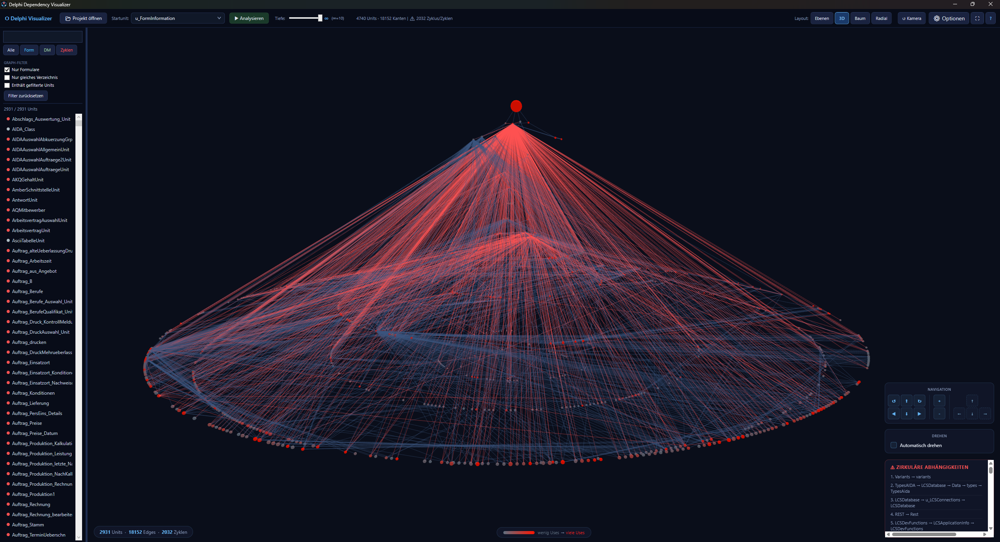

# Delphi Dependency Visualizer

Interactive 3D visualization of Delphi unit dependencies. Analyzes `.dpr` projects and renders the dependency graph in a navigable 3D view — including circular dependency detection and heatmap coloring.



## Features

- **4 layout modes** — Layered, 3D Force, Tree, Radial
- **Heatmap coloring** — units with many dependencies glow red
- **Circular dependency detection** — listed and highlighted
- **Filters** — show only Forms, DataModules, or cyclic units
- **Adjustable depth** — limit analysis to N levels
- **Self-contained** — no .NET installation required

## Requirements

- Windows 10 / 11 (x64)
- [WebView2 Runtime](https://developer.microsoft.com/en-us/microsoft-edge/webview2/) (pre-installed on Windows 11)

## Installation

Download the latest installer from [Releases](../../releases) and run it. No admin rights required.

## Usage

1. Click **Open Project** and select a `.dpr` file (or a `.gv`/`.dot` file exported
   by the Delphi 12+ compiler switch `--graphviz`)
2. Choose a start unit and analysis depth
3. Click **Analyse**
4. Navigate with mouse: rotate, zoom, click nodes for details

## Sample project

A bundled demo project ships in `SampleProject/AcmeERP/` (also installed next to the
executable). It is a synthetic ~520-unit Delphi application (50 feature modules of
10 units each) with a mega-hub main form, cross-cutting utility units and ~70 cycles
— including `uAppContext`, which every form uses and which itself pulls in the main
form, so `fMain` and all forms form one big strongly-connected component. Enough to
exercise every layout, the heatmap and the progress bar without pointing at your own source.

- `AcmeERP.dpr` — full parser path; start unit `fMain`, depth ∞
- `AcmeERP.gv` — same graph in Delphi 12 `--graphviz` format (compiler-resolved edges)

## Build from source

```bat
build.bat
```

Requires [.NET 8 SDK](https://dotnet.microsoft.com/download).
